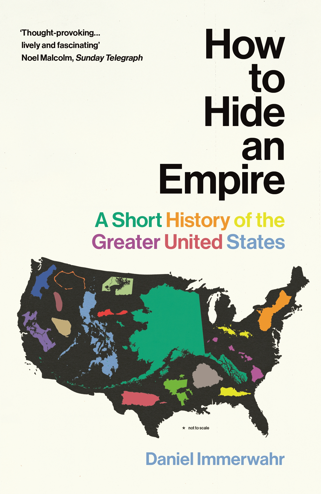

*The contents of this page reflect my own opinions and not those of any employer or other organisation.*

**Food and Drink**  
- My opinions related to food and drink, and in particular a list of restaurants which I recommend, can be found <a href="https://tilde.green/~alec/foodanddrink.html">here</a>.  

**Films**  
- You can find my Letterboxd profile <a href="https://letterboxd.com/preludeto110/">here</a>; my favourite film is <a href="https://www.youtube.com/watch?v=mBKG6oaeCGw">*The Ruling Class*</a> (1972).

**Music**
- I record experimental and ambient music using modular synthesisers, found sounds, and musical instruments both acoustic and electronic; it is available to stream and download <a href="https://acritten.bandcamp.com/">on Bandcamp</a>.
- My <a href="https://www.last.fm/user/preludeto110">last.fm page</a> will tell you what I'm currently listening to (very likely something by the band The Magnetic Fields).

**Books**
- My favourite books are *In Watermelon Sugar* by Richard Brautigan, *Infinite Jest* by David Foster Wallace, *Giovanni's Room* by James Baldwin, and the poetry collection *Actual Air* by David Berman.
- I'm currently reading "How to Hide an Empire: A Short History of the Greater United States" by Daniel Immerwahr.

       

  <!-- Music will be injected here -->
  

  <!-- Artwork will be injected here -->
  <figure id="artwork"></figure>

